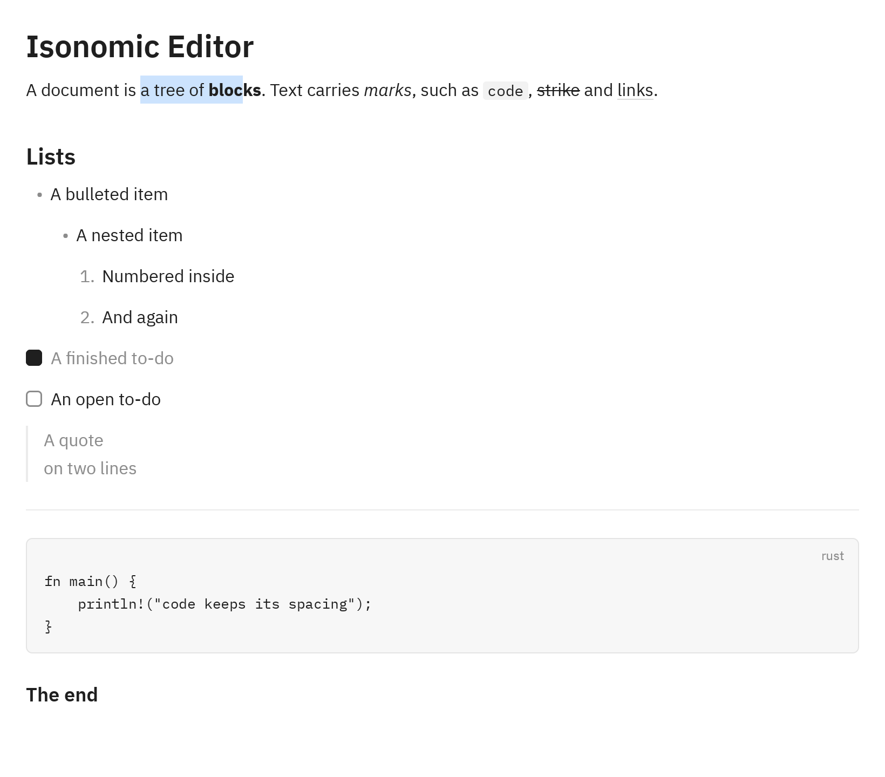
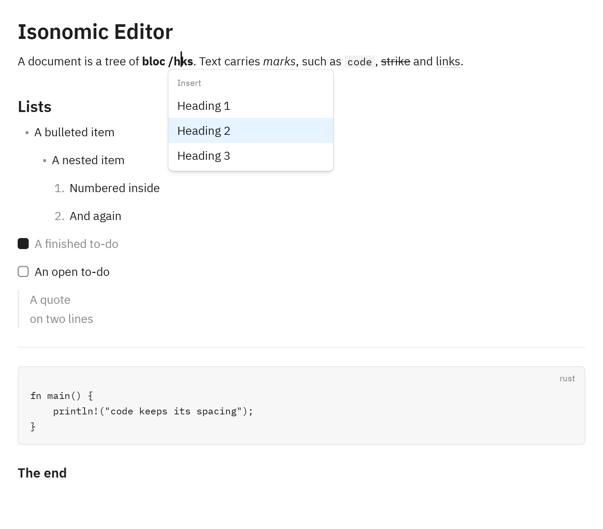

# Isonomic Editor

The block editor engine for Isonomic apps: a document model, a replicated store, editing commands, formats, the standard blocks, and the editor view.

A document is a tree of blocks. Each block has a stable ID, a type, properties, and rich text made of UTF-8 text plus mark ranges. Every edit is a transaction of nine primitive operations, so undo, sync, agents and the view all share one path.





The frames above are the real renderer, run offscreen: `cargo run -p editor-gpui --example screenshot -- editor.png` and `... -- editor-menu.png menu`.

## Layout

| Crate | Role |
|---|---|
| `editor-model` | IDs, the block tree snapshot, inline text, marks, positions, selections, operations, the schema registry, limits. |
| `editor-store` | The replicated document: atomic transactions, local-only undo, anchors, export and import. |
| `editor-commands` | Editing commands, input rules and normalization, as pure functions. |
| `editor-formats` | Canonical JSON (`isonomic.doc/1`), Markdown, HTML and plain text. |
| `editor-blocks` | Specs for the standard blocks and the insert menu. |
| `ui` | The component library, re-exported at one pinned revision. |
| `editor-gpui` | The view: state, the rows in view drawn through the text seam, pointer, keyboard, platform text input, the insert menu. |
| `xtask` | Repository checks. |

The view crates need the component library's system dependencies to build; the headless crates do not. See `docs/status.md` for where things stand.

## Use

```rust
use std::sync::Arc;
use editor_blocks::{normalizer, standard_registry};
use editor_commands as cmd;
use editor_model::*;
use editor_store::Store;

let mut store = Store::new(Arc::new(standard_registry()), replica_id);
store.set_normalizer(normalizer());

// A command reads a snapshot and returns a transaction, or `None`.
let doc = store.snapshot();
if let Some(tx) = cmd::insert_text(&doc, &selection, "Hello", None) {
    store.apply(&tx, Some(&selection))?;
}

// Sync is bytes in, bytes out; any transport can carry them.
let update = store.export_since(&their_version)?;
other.import(&update)?;
```

## Try it

```sh
cargo run -p editor-gpui --example playground
```

Opens the editor in a window. `cargo run --release -p editor-gpui --example frames` times the editor's share of a frame on a document of 10,000 blocks. Both need the component library's system dependencies; on Linux those are the usual windowing, font and Vulkan development packages.

Keys, typing shortcuts and pointer gestures are listed in `docs/keys.md`.

## Develop

```sh
cargo test            # headless crates; no GPU needed
cargo test --workspace  # adds the view crate, in a headless window
cargo clippy --all-targets -- -D warnings
cargo xtask deps      # headless crates stay headless
cargo xtask sizes     # every file under 20 KB
```

The specification is in `docs/spec.md`. Working rules are in `CLAUDE.md`. Current state is in `docs/status.md`.
